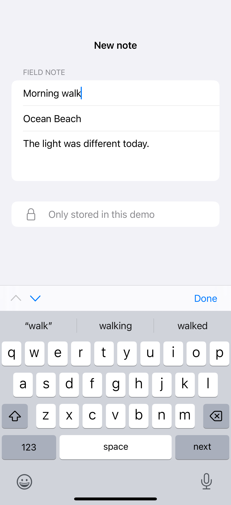
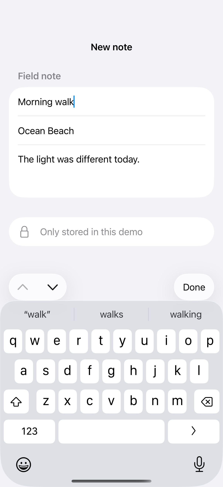

# Keyboard toolbars

A keyboard toolbar places editing actions above the software keyboard and can use focus state to move between fields.

## SwiftUI

```swift
import SwiftUI

struct KeyboardActions: View {
    @State private var name = ""
    @FocusState private var focused: Bool
    var body: some View {
        TextField("Name", text: $name).focused($focused)
            .textFieldStyle(.roundedBorder).padding()
            .toolbar {
                ToolbarItemGroup(placement: .keyboard) {
                    Spacer()
                    Button("Done") { focused = false }
                }
            }
    }
}
```

## Captures

<!-- captures:start -->
### iPhone 16 Pro · iOS 18.5

default. light appearance; Large text; en_US.



### iPhone 17 Pro · iOS 26.5

default. light appearance; Large text; en_US.


<!-- captures:end -->

## Full example

[Open the complete runnable example](KeyboardToolbarsDemo.swift).

## Reference

[Apple: ToolbarItemPlacement.keyboard](https://developer.apple.com/documentation/swiftui/toolbaritemplacement/keyboard).
