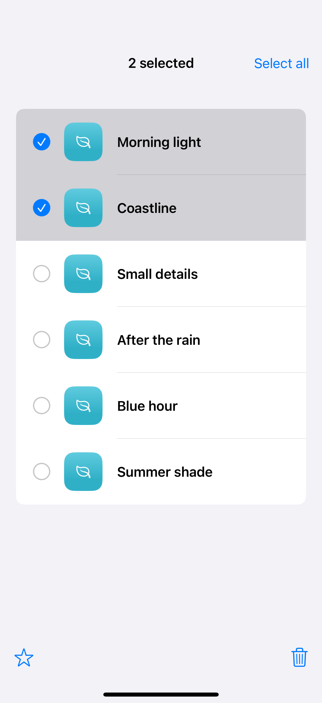
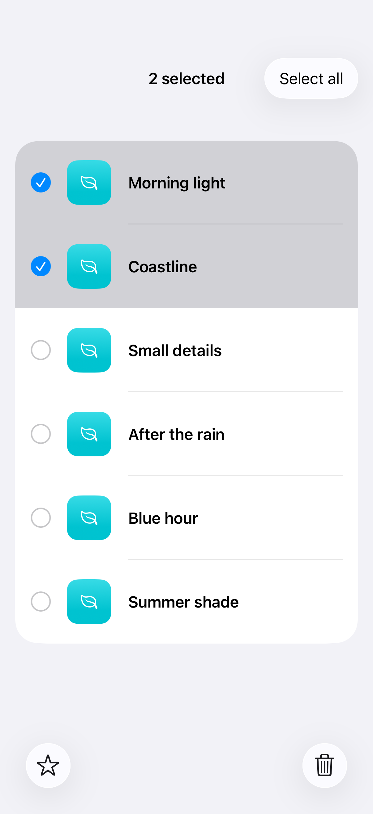

# Selection-dependent toolbars

A selection-dependent toolbar changes its actions and availability to match the items selected in the content.

## SwiftUI

```swift
import SwiftUI

struct SelectedItemActions: View {
    @State private var items = ["Coast", "Forest", "Desert"]
    @State private var selected: Set<String> = []
    var body: some View {
        List(items, id: \.self, selection: $selected) { Text($0) }
            .environment(\.editMode, .constant(.active))
            .toolbar {
                ToolbarItem(placement: .bottomBar) {
                    Button("Delete", systemImage: "trash", role: .destructive) {
                        items.removeAll { selected.contains($0) }
                        selected.removeAll()
                    }.disabled(selected.isEmpty)
                }
            }
    }
}
```

## Captures

<!-- captures:start -->
### iPhone 16 Pro · iOS 18.5

default. light appearance; Large text; en_US.



### iPhone 17 Pro · iOS 26.5

default. light appearance; Large text; en_US.


<!-- captures:end -->

## Full example

[Open the complete runnable example](SelectionToolbarsDemo.swift).

## Reference

[Apple: toolbar](https://developer.apple.com/documentation/swiftui/view/toolbar(content:)).
