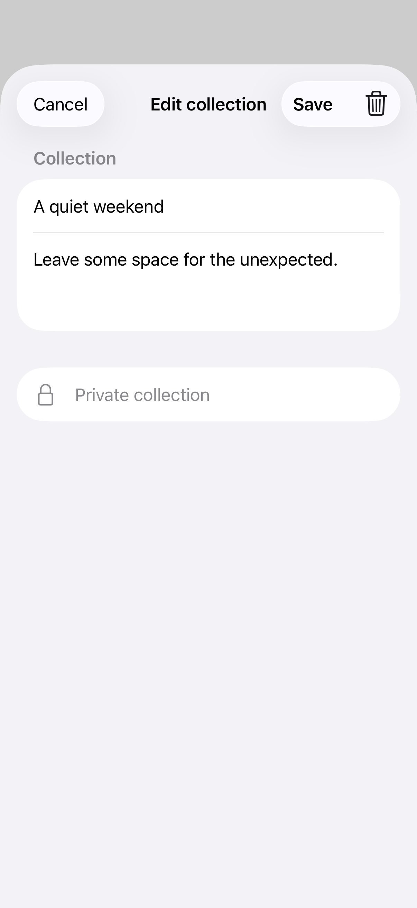

# Toolbar action roles

Confirmation, cancellation, and destructive placements describe what an action does so the system can give it an appropriate position.

## SwiftUI

```swift
import SwiftUI

struct EditingToolbar: View {
    @Environment(\.dismiss) private var dismiss
    @State private var name = "Weekend"
    var body: some View {
        NavigationStack {
            Form { TextField("Name", text: $name) }
                .navigationTitle("Edit collection")
                .toolbar {
                    ToolbarItem(placement: .cancellationAction) {
                        Button("Cancel", role: .cancel) { dismiss() }
                    }
                    ToolbarItem(placement: .confirmationAction) {
                        Button("Save") { dismiss() }
                            .disabled(name.isEmpty)
                    }
                }
        }
    }
}
```

## Captures

<!-- captures:start -->
### iPhone 17 Pro · iOS 26.5

default. light appearance; Large text; en_US.


<!-- captures:end -->

## Full example

[Open the complete runnable example](ToolbarActionRolesDemo.swift).

## Reference

[Apple: ToolbarItemPlacement](https://developer.apple.com/documentation/swiftui/toolbaritemplacement).
