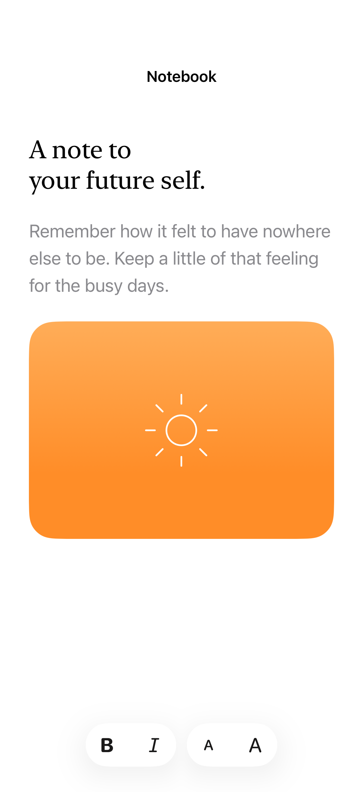

# Toolbar groups and backgrounds

Toolbar spacers separate groups of actions, and shared background visibility controls whether an item participates in the system’s grouped surface.

## SwiftUI

```swift
import SwiftUI

@available(iOS 26.0, *)
struct GroupedActions: View {
    var body: some View {
        Text("Notebook").toolbar {
            ToolbarItemGroup(placement: .bottomBar) {
                Button("Undo", systemImage: "arrow.uturn.backward") { }
                Button("Redo", systemImage: "arrow.uturn.forward") { }
            }
            ToolbarSpacer(.fixed, placement: .bottomBar)
            ToolbarItem(placement: .bottomBar) {
                Button("Add", systemImage: "plus") { }
            }.sharedBackgroundVisibility(.hidden)
        }
    }
}
```

## Captures

<!-- captures:start -->
### iPhone 17 Pro · iOS 26.5

default. light appearance; Large text; en_US.


<!-- captures:end -->

## Full example

[Open the complete runnable example](ToolbarGroupsDemo.swift).

## Reference

[Apple: ToolbarSpacer](https://developer.apple.com/documentation/swiftui/toolbarspacer).
