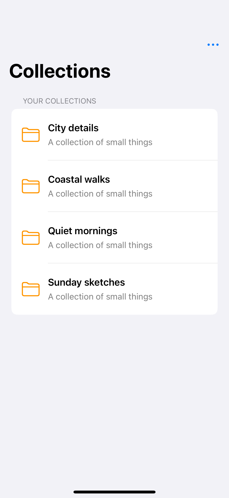
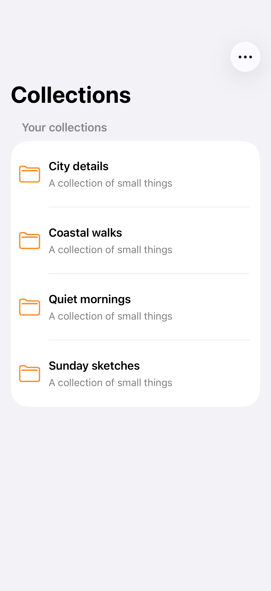

# Toolbar menus

A toolbar menu keeps less frequent actions close at hand and can contain sections, nested menus, and selection controls.

## SwiftUI

```swift
import SwiftUI

struct MenuToolbar: View {
    @State private var sort = "Name"
    var body: some View {
        Text("Collections").toolbar {
            ToolbarItem(placement: .topBarTrailing) {
                Menu {
                    Button("New collection", systemImage: "folder.badge.plus") { }
                    Menu("Sort by") {
                        Picker("Order", selection: $sort) {
                            Text("Name").tag("Name")
                            Text("Added").tag("Added")
                        }
                    }
                } label: { Label("Actions", systemImage: "ellipsis") }
            }
        }
    }
}
```

## Captures

<!-- captures:start -->
### iPhone 16 Pro · iOS 18.5

default. light appearance; Large text; en_US.



### iPhone 17 Pro · iOS 26.5

default. light appearance; Large text; en_US.



### iPhone 18 Pro · iOS 27.0

default. light appearance; Large text; en_US.


<!-- captures:end -->

## Full example

[Open the complete runnable example](ToolbarMenusDemo.swift).

## Reference

[Apple: Menu](https://developer.apple.com/documentation/swiftui/menu).
