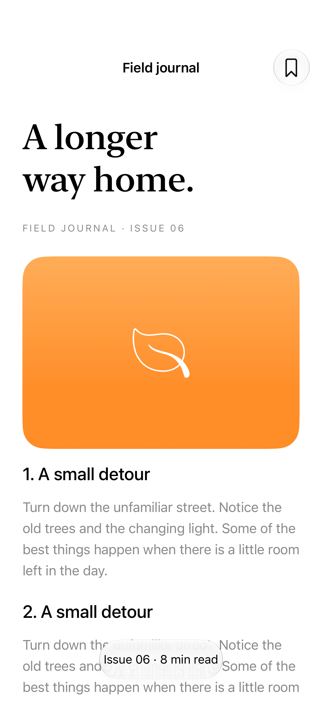

# Toolbar minimization

Toolbar minimization can reduce bars while scrolling and restore them automatically or when the scroll view returns to an edge.

## SwiftUI

```swift
import SwiftUI

@available(iOS 27.0, *)
struct RecedingToolbar: View {
    var body: some View {
        ScrollView {
            LazyVStack {
                ForEach(1...60, id: \.self) { Text("Field note \($0)").padding() }
            }.frame(maxWidth: .infinity)
        }
        .navigationTitle("Field journal")
        .toolbarMinimizationBehavior(.onScrollDown, for: .navigationBar)
        .toolbarMinimizationRestoration(.atScrollEdge, for: .navigationBar)
    }
}
```

## Captures

<!-- captures:start -->
### iPhone 18 Pro · iOS 27.0

default. light appearance; Large text; en_US.


<!-- captures:end -->

## Full example

[Open the complete runnable example](ToolbarMinimizationDemo.swift).

## Reference

[Apple: toolbarMinimizationBehavior](https://developer.apple.com/documentation/swiftui/view/toolbarminimizationbehavior(_:for:)).
