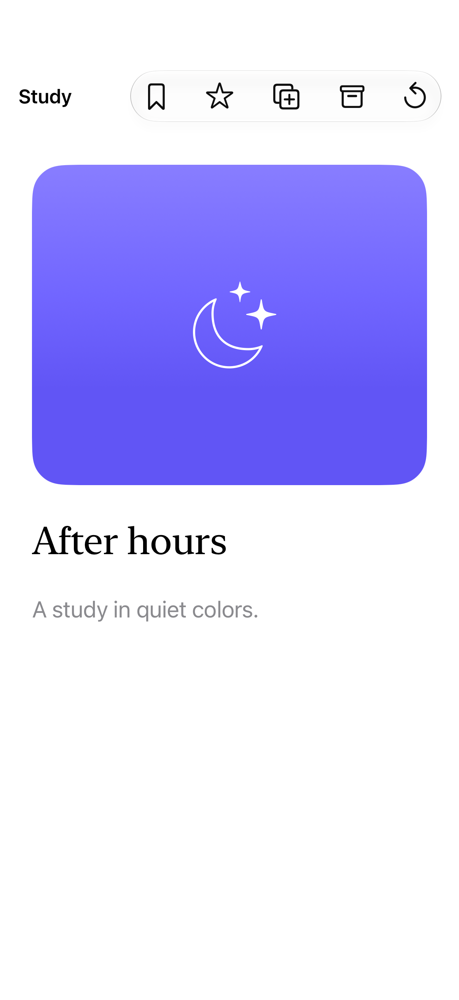

# Toolbar overflow and priority

Toolbar visibility priorities tell the system which actions should remain prominent when a bar has more items than available space.

## SwiftUI

```swift
import SwiftUI

@available(iOS 27.0, *)
struct PrioritizedToolbar: View {
    var body: some View {
        Text("Study").toolbar {
            ToolbarItem(placement: .topBarTrailing) {
                Button("Save", systemImage: "bookmark") { }
            }.visibilityPriority(.high)
            ToolbarItem(placement: .topBarTrailing) {
                Button("Duplicate", systemImage: "plus.square.on.square") { }
            }.visibilityPriority(.low)
        }
    }
}
```

## Captures

<!-- captures:start -->
### iPhone 18 Pro · iOS 27.0

default. light appearance; Large text; en_US.


<!-- captures:end -->

## Full example

[Open the complete runnable example](ToolbarOverflowDemo.swift).

## Reference

[Apple: visibilityPriority](https://developer.apple.com/documentation/swiftui/toolbaritemvisibilitypriority).
