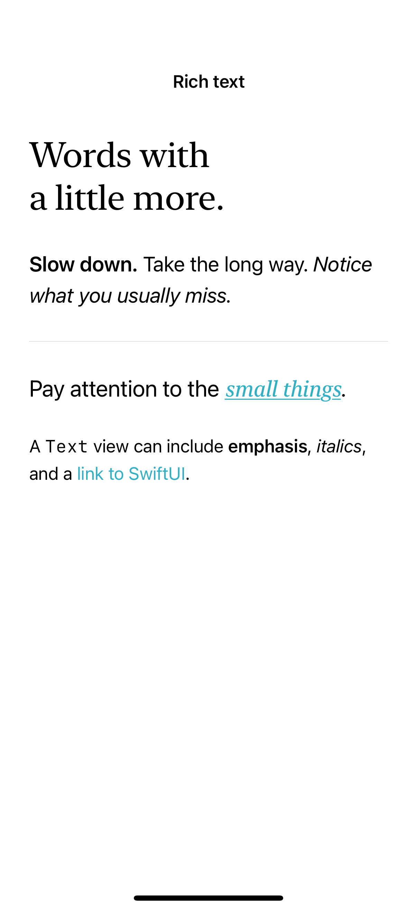
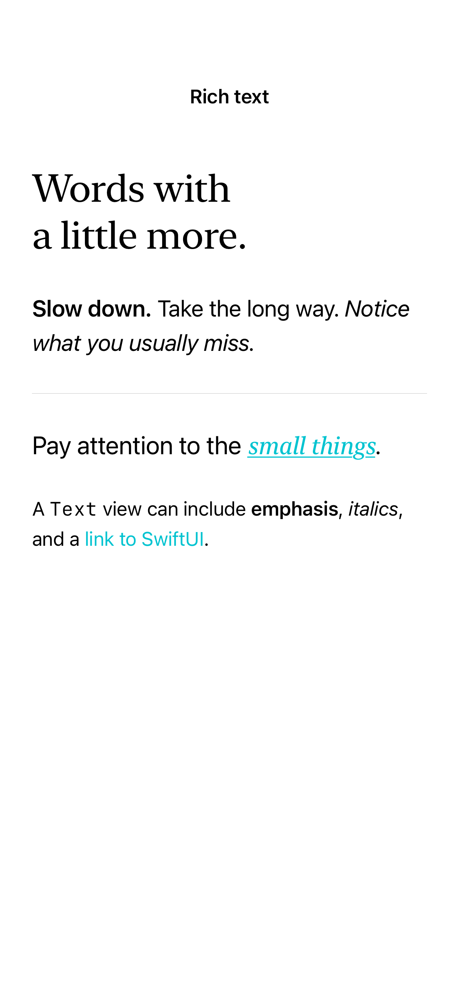

# Attributed text and Markdown

Attributed strings and inline Markdown allow one text view to contain emphasis, links, and custom styling.

## SwiftUI

```swift
import SwiftUI

struct InlineMarkdown: View {
    var body: some View {
        Text("**Slow down.** Notice the *small things*. [Learn about SwiftUI](https://developer.apple.com/swiftui/).")
            .font(.title3).lineSpacing(6).tint(.teal)
            .padding()
    }
}
```

## Captures

<!-- captures:start -->
### iPhone 16 Pro · iOS 18.5

default. light appearance; Large text; en_US.



### iPhone 17 Pro · iOS 26.5

default. light appearance; Large text; en_US.


### iPhone 18 Pro · iOS 27.0

default. light appearance; Large text; en_US.


<!-- captures:end -->

## Full example

[Open the complete runnable example](AttributedTextMarkdownDemo.swift).

## Reference

[Apple: AttributedString](https://developer.apple.com/documentation/foundation/attributedstring).
