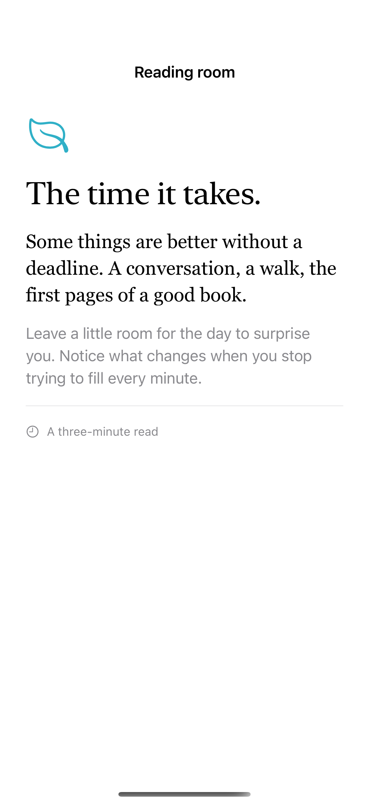
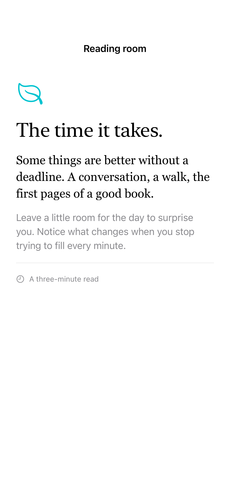

# Dynamic Type and readable width

Dynamic Type can scale a custom font and nearby layout dimensions, while a maximum content width keeps long lines readable on wider windows.

## SwiftUI

```swift
import SwiftUI

struct ScaledReadingText: View {
    @ScaledMetric(relativeTo: .body) private var spacing = 20.0
    var body: some View {
        VStack(alignment: .leading, spacing: spacing) {
            Text("The time it takes.").font(.largeTitle)
            Text("Some things are better without a deadline.")
                .font(.custom("Georgia", size: 21, relativeTo: .body))
        }
        .frame(maxWidth: 600, alignment: .leading)
        .padding(24).frame(maxWidth: .infinity)
    }
}
```

## Captures

<!-- captures:start -->
### iPhone 16 Pro · iOS 18.5

default. light appearance; Large text; en_US.



### iPhone 17 Pro · iOS 26.5

default. light appearance; Large text; en_US.



### iPhone 18 Pro · iOS 27.0

default. light appearance; Large text; en_US.


<!-- captures:end -->

## Full example

[Open the complete runnable example](DynamicTypeReadableWidthDemo.swift).

## Reference

[Apple: ScaledMetric](https://developer.apple.com/documentation/swiftui/scaledmetric).
