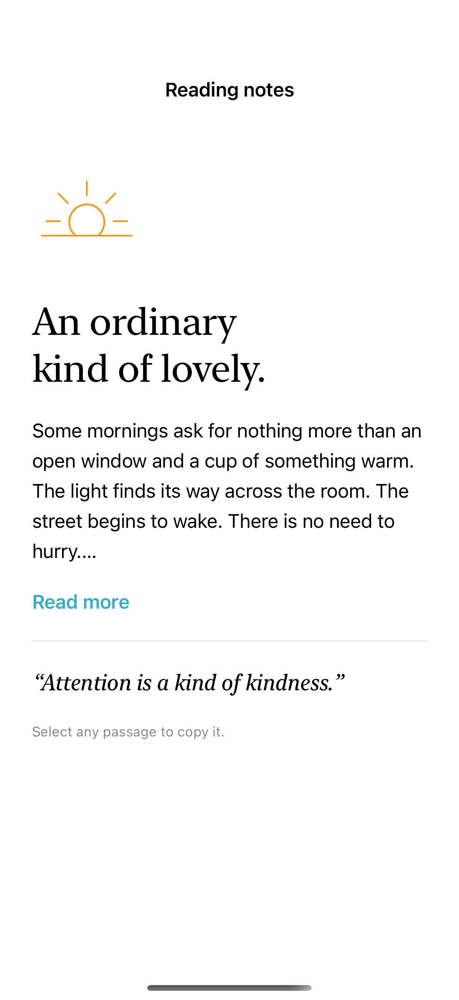
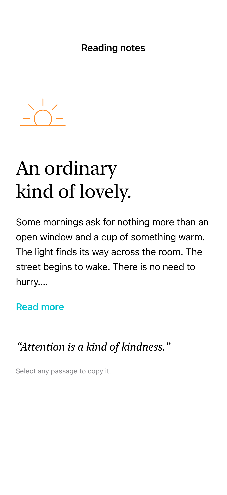

# Expandable and selectable text

An expandable passage can reveal more text on demand, and text selection lets readers copy words from read-only content.

## SwiftUI

```swift
import SwiftUI

struct ReadMore: View {
    @State private var expanded = false
    let passage: String
    var body: some View {
        VStack(alignment: .leading, spacing: 12) {
            Text(passage).lineLimit(expanded ? nil : 3)
                .textSelection(.enabled)
            Button(expanded ? "Read less" : "Read more") {
                withAnimation { expanded.toggle() }
            }
        }
    }
}
```

## Captures

<!-- captures:start -->
### iPhone 16 Pro · iOS 18.5

default. light appearance; Large text; en_US.



### iPhone 17 Pro · iOS 26.5

default. light appearance; Large text; en_US.


### iPhone 18 Pro · iOS 27.0

default. light appearance; Large text; en_US.


<!-- captures:end -->

## Full example

[Open the complete runnable example](ExpandableSelectableTextDemo.swift).

## Reference

[Apple: lineLimit](https://developer.apple.com/documentation/swiftui/view/textselection(_:)).
