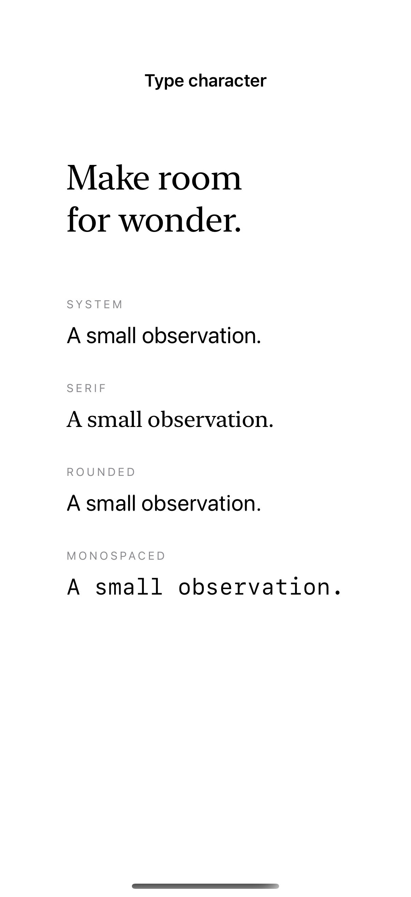
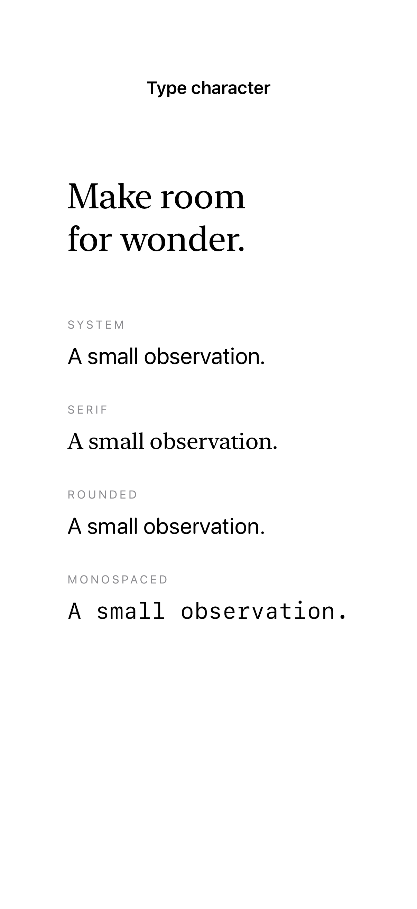

# Font design, weight, and width

System fonts offer different designs, weights, and widths while retaining the platform’s text metrics and accessibility behavior.

## SwiftUI

```swift
import SwiftUI

struct SystemFontDesign: View {
    var body: some View {
        VStack(alignment: .leading, spacing: 16) {
            Text("Make room for wonder.")
                .font(.system(.largeTitle, design: .serif).weight(.medium))
            Text("A small observation.")
                .font(.title2).fontWidth(.condensed)
        }.padding()
    }
}
```

## Captures

<!-- captures:start -->
### iPhone 16 Pro · iOS 18.5

default. light appearance; Large text; en_US.



### iPhone 17 Pro · iOS 26.5

default. light appearance; Large text; en_US.


### iPhone 18 Pro · iOS 27.0

default. light appearance; Large text; en_US.


<!-- captures:end -->

## Full example

[Open the complete runnable example](FontDesignWeightWidthDemo.swift).

## Reference

[Apple: Font.Design](https://developer.apple.com/documentation/swiftui/font/design).
