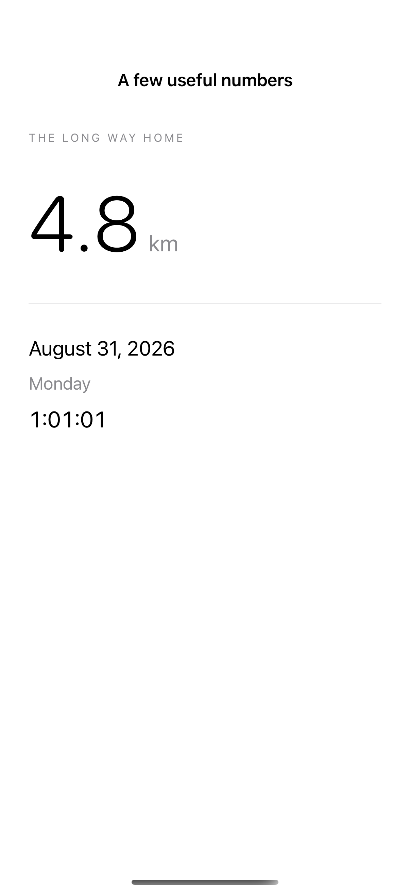
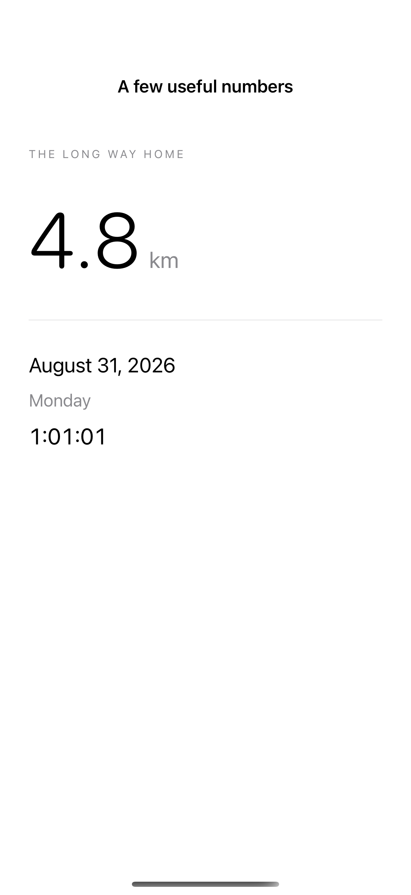
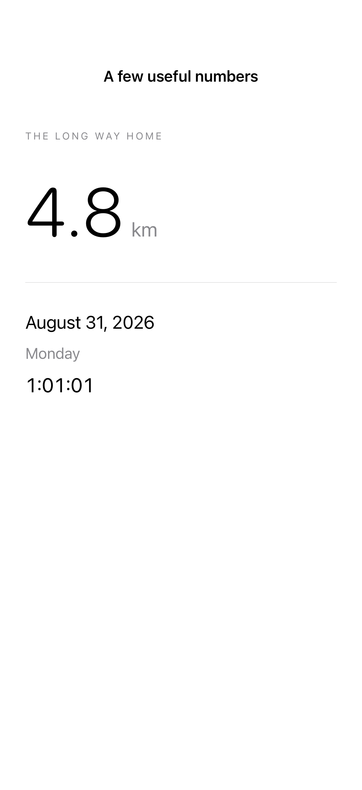

# Numbers, dates, and timers

Monospaced digits keep changing numbers steady, while native date and duration formats adapt to locale and context.

## SwiftUI

```swift
import SwiftUI

struct StableCounter: View {
    @State private var count = 48
    var body: some View {
        VStack(spacing: 24) {
            Text(count, format: .number)
                .font(.system(size: 64, weight: .light))
                .monospacedDigit().contentTransition(.numericText())
            Button("Add one") { withAnimation { count += 1 } }
        }
    }
}
```

## Captures

<!-- captures:start -->
### iPhone 16 Pro · iOS 18.5

default. light appearance; Large text; en_US.



### iPhone 17 Pro · iOS 26.5

default. light appearance; Large text; en_US.



### iPhone 18 Pro · iOS 27.0

default. light appearance; Large text; en_US.


<!-- captures:end -->

## Full example

[Open the complete runnable example](NumbersDatesTimersDemo.swift).

## Reference

[Apple: monospacedDigit](https://developer.apple.com/documentation/swiftui/view/monospaceddigit()).
