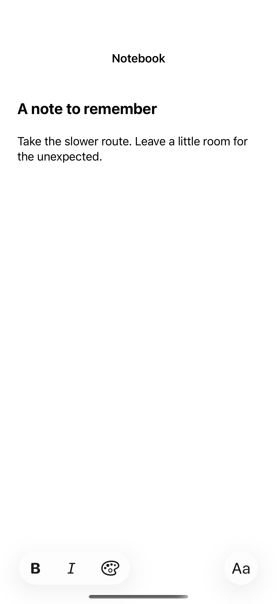

# Rich-text editing

An attributed-text editor preserves formatting while editing, and selection-aware transformations apply styles to the selected text or insertion point.

## SwiftUI

```swift
import SwiftUI

@available(iOS 26.0, *)
struct FormattedEditor: View {
    @State private var text = AttributedString("A note to remember")
    @State private var selection = AttributedTextSelection()
    var body: some View {
        TextEditor(text: $text, selection: $selection)
            .toolbar {
                ToolbarItem(placement: .bottomBar) {
                    Button("Bold", systemImage: "bold") {
                        text.transformAttributes(in: &selection) {
                            $0.font = .body.bold()
                        }
                    }
                }
            }
    }
}
```

## Captures

<!-- captures:start -->
### iPhone 17 Pro · iOS 26.5

default. light appearance; Large text; en_US.


<!-- captures:end -->

## Full example

[Open the complete runnable example](RichTextEditorDemo.swift).

## Reference

[Apple: TextEditor](https://developer.apple.com/documentation/swiftui/texteditor).
