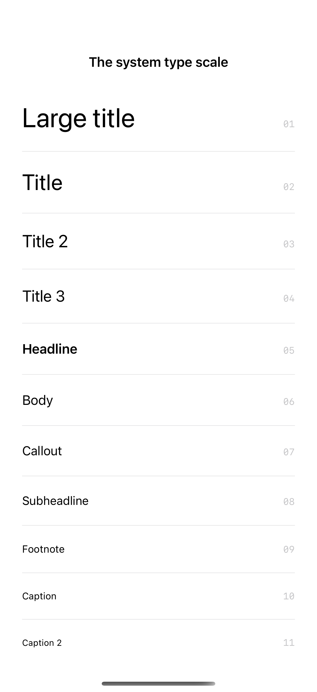
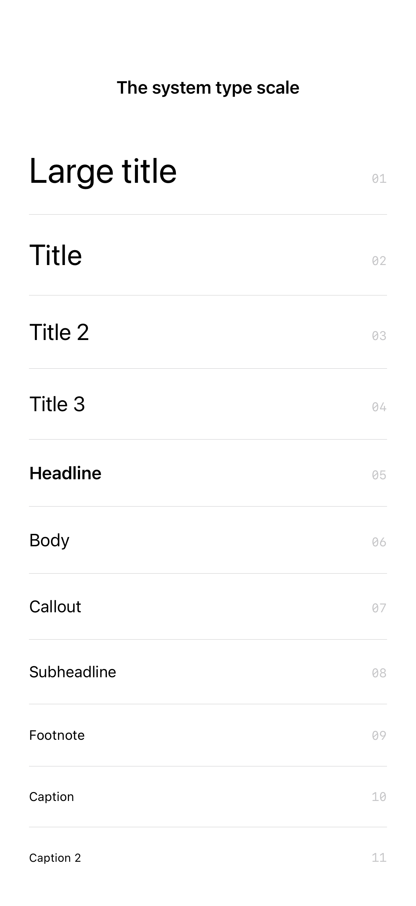

# System text styles

Semantic text styles express hierarchy and resize with the user’s preferred text size.

## SwiftUI

```swift
import SwiftUI

struct SemanticType: View {
    var body: some View {
        VStack(alignment: .leading, spacing: 12) {
            Text("A quiet morning").font(.largeTitle)
            Text("A little room to think.").font(.headline)
            Text("Semantic styles adapt to Dynamic Type.").font(.body)
            Text("FIELD NOTES / 01").font(.caption)
                .foregroundStyle(.secondary)
        }.padding()
    }
}
```

## Captures

<!-- captures:start -->
### iPhone 16 Pro · iOS 18.5

default. light appearance; Large text; en_US.



### iPhone 17 Pro · iOS 26.5

default. light appearance; Large text; en_US.


### iPhone 18 Pro · iOS 27.0

default. light appearance; Large text; en_US.


<!-- captures:end -->

## Full example

[Open the complete runnable example](SystemTextStylesDemo.swift).

## Reference

[Apple: Font.TextStyle](https://developer.apple.com/documentation/swiftui/font/textstyle).
