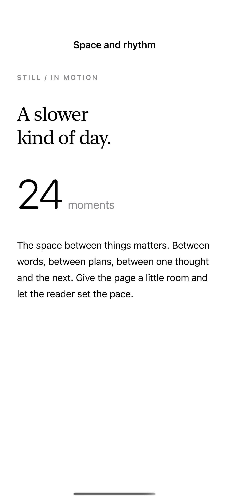
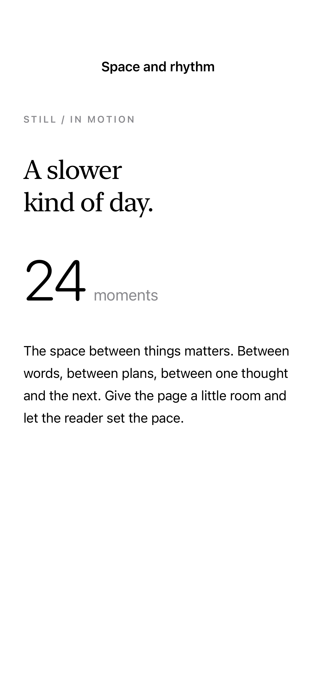

# Spacing and baselines

Baseline alignment keeps mixed text sizes on a common line, while tracking, kerning, and line spacing control the rhythm of text.

## SwiftUI

```swift
import SwiftUI

struct SharedBaseline: View {
    var body: some View {
        VStack(alignment: .leading, spacing: 24) {
            Text("FIELD NOTES").font(.caption).tracking(2)
            HStack(alignment: .firstTextBaseline) {
                Text("24").font(.system(size: 64, weight: .light))
                Text("moments").font(.title3)
            }
            Text("Leave a little space between one thought and the next.")
                .lineSpacing(6)
        }.padding()
    }
}
```

## Captures

<!-- captures:start -->
### iPhone 16 Pro · iOS 18.5

default. light appearance; Large text; en_US.



### iPhone 17 Pro · iOS 26.5

default. light appearance; Large text; en_US.


<!-- captures:end -->

## Full example

[Open the complete runnable example](TextSpacingBaselinesDemo.swift).

## Reference

[Apple: tracking](https://developer.apple.com/documentation/swiftui/view/linespacing(_:)).
