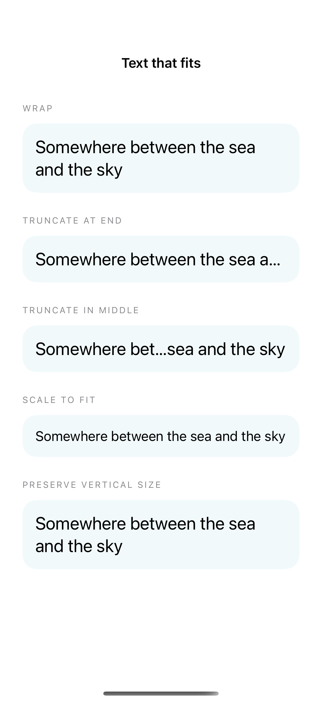
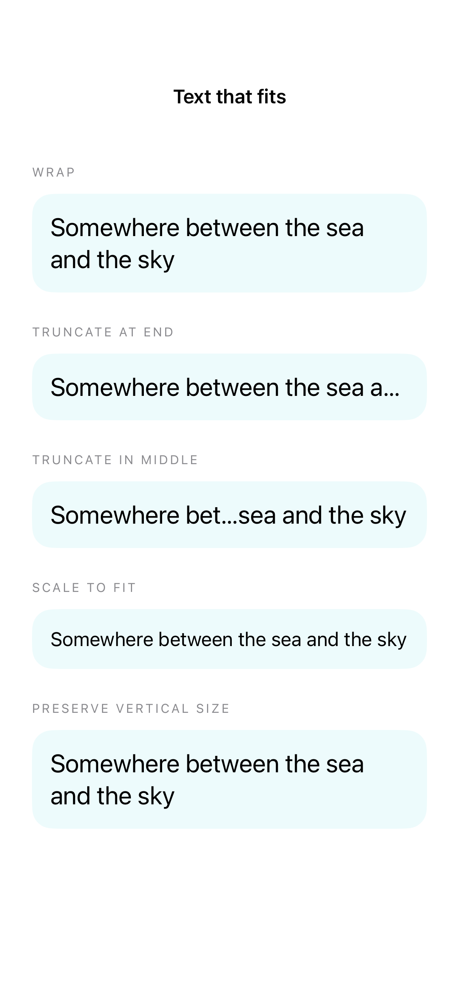

# Wrapping, truncation, and scaling

Line limits, truncation, minimum scaling, and fixed sizing produce different results when text has less space than it needs.

## SwiftUI

```swift
import SwiftUI

struct ConstrainedTitle: View {
    var body: some View {
        VStack(alignment: .leading, spacing: 20) {
            Text("Somewhere between the sea and the sky")
                .lineLimit(1).truncationMode(.middle)
            Text("Somewhere between the sea and the sky")
                .lineLimit(1).minimumScaleFactor(0.6)
            Text("Somewhere between the sea and the sky")
                .fixedSize(horizontal: false, vertical: true)
        }.font(.title2).frame(width: 260)
    }
}
```

## Captures

<!-- captures:start -->
### iPhone 16 Pro · iOS 18.5

default. light appearance; Large text; en_US.



### iPhone 17 Pro · iOS 26.5

default. light appearance; Large text; en_US.


### iPhone 18 Pro · iOS 27.0

default. light appearance; Large text; en_US.


<!-- captures:end -->

## Full example

[Open the complete runnable example](TextWrappingTruncationDemo.swift).

## Reference

[Apple: lineLimit](https://developer.apple.com/documentation/swiftui/view/linelimit(_:)).
