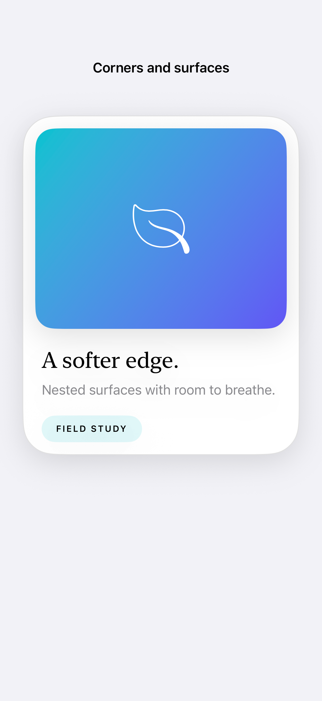

# Concentric shapes and elevation

A concentric rectangle derives its corner shape from its container, helping nested surfaces keep a consistent inset relationship.

## SwiftUI

```swift
import SwiftUI

@available(iOS 26.0, *)
struct NestedCorners: View {
    var body: some View {
        Rectangle().fill(.teal.gradient)
            .frame(height: 240)
            .clipShape(ConcentricRectangle())
            .padding(16)
            .background(.background, in: RoundedRectangle(cornerRadius: 40))
            .containerShape(RoundedRectangle(cornerRadius: 40))
    }
}
```

## Captures

<!-- captures:start -->
### iPhone 17 Pro · iOS 26.5

default. light appearance; Large text; en_US.


<!-- captures:end -->

## Full example

[Open the complete runnable example](ConcentricShapesDemo.swift).

## Reference

[Apple: ConcentricRectangle](https://developer.apple.com/documentation/swiftui/concentricrectangle).
