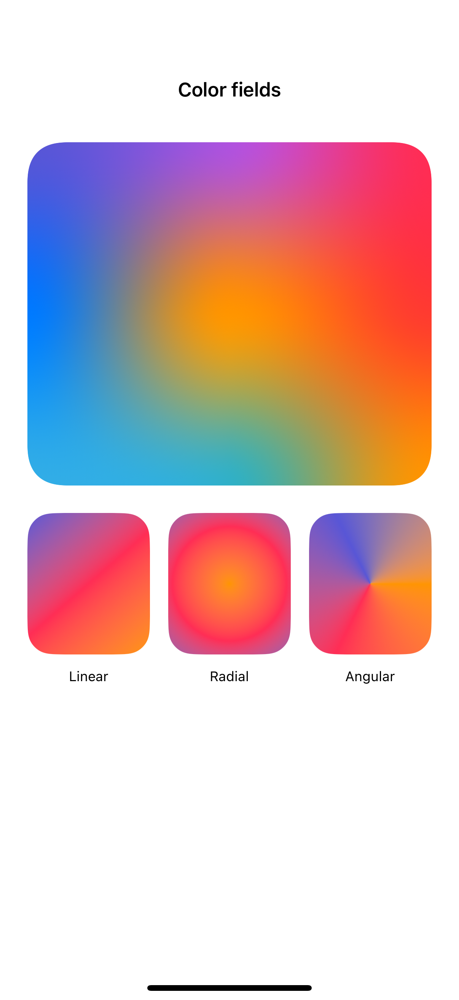
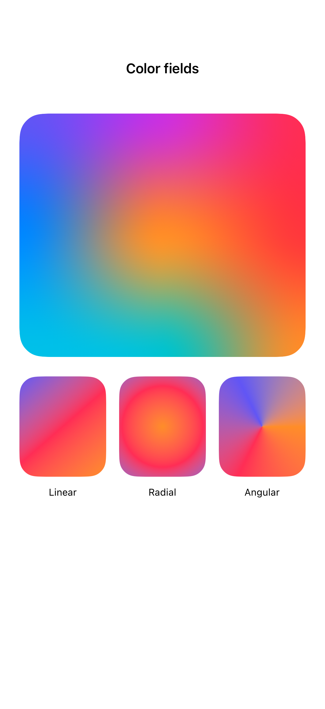

# Gradients and mesh gradients

Gradients interpolate color across a shape; a mesh gradient adds movable control points for a more flexible blend.

## SwiftUI

```swift
import SwiftUI

struct FourCornerMesh: View {
    var body: some View {
        MeshGradient(width: 2, height: 2,
                     points: [[0, 0], [1, 0], [0, 1], [1, 1]],
                     colors: [.indigo, .pink, .teal, .orange])
            .frame(height: 280)
            .clipShape(RoundedRectangle(cornerRadius: 28))
    }
}
```

## Captures

<!-- captures:start -->
### iPhone 16 Pro · iOS 18.5

default. light appearance; Large text; en_US.



### iPhone 17 Pro · iOS 26.5

default. light appearance; Large text; en_US.



### iPhone 18 Pro · iOS 27.0

default. light appearance; Large text; en_US.


<!-- captures:end -->

## Full example

[Open the complete runnable example](GradientsMeshDemo.swift).

## Reference

[Apple: LinearGradient](https://developer.apple.com/documentation/swiftui/meshgradient).
