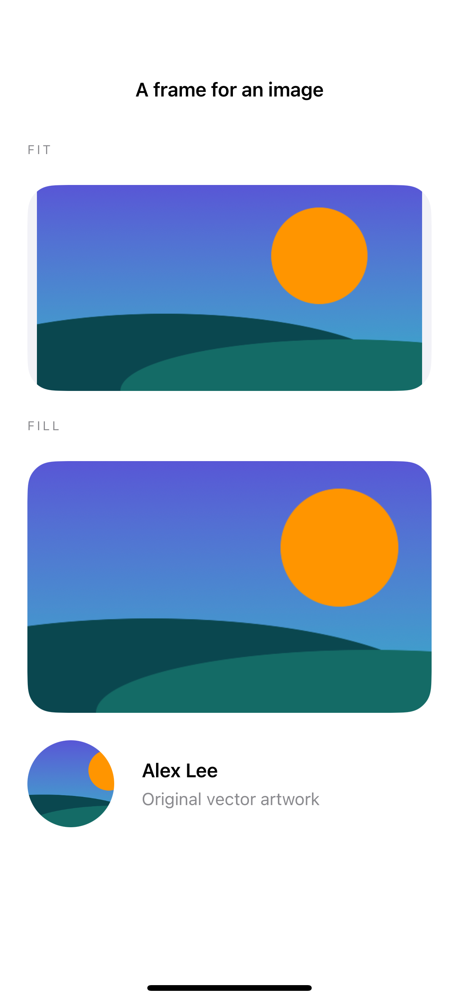

# Image fitting and avatar fallbacks

Aspect-fit preserves the entire image, while aspect-fill covers its frame and clips excess content; an avatar can fall back to initials when no image is available.

## SwiftUI

```swift
import SwiftUI

struct FittedImage: View {
    let image: Image
    var body: some View {
        VStack(spacing: 24) {
            image.resizable().scaledToFit()
                .frame(width: 280, height: 180)
            image.resizable().scaledToFill()
                .frame(width: 280, height: 180).clipped()
                .clipShape(RoundedRectangle(cornerRadius: 24))
        }
    }
}
```

## Captures

<!-- captures:start -->
### iPhone 16 Pro · iOS 18.5

default. light appearance; Large text; en_US.


<!-- captures:end -->

## Full example

[Open the complete runnable example](ImageFittingAvatarsDemo.swift).

## Reference

[Apple: scaledToFit](https://developer.apple.com/documentation/swiftui/view/scaledtofill()).
