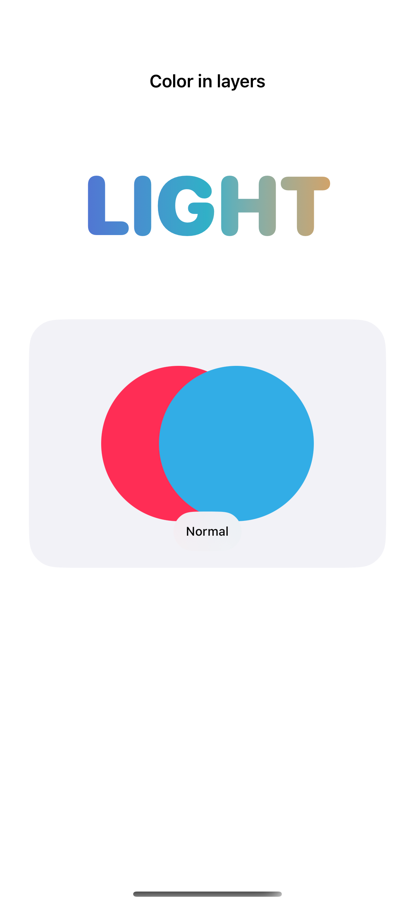
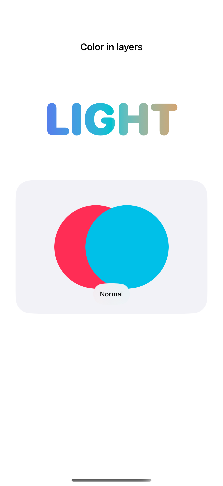
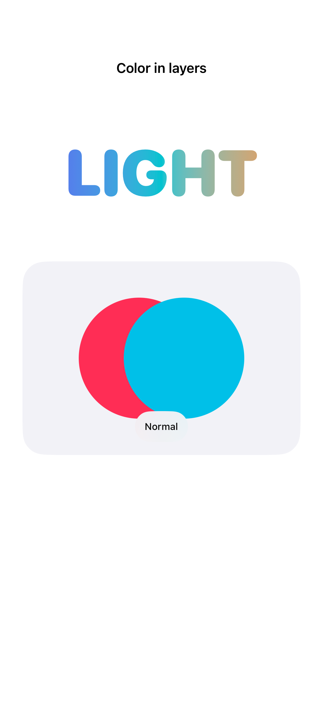

# Masks, blending, and overlays

Masks use opacity to reveal content, while blend modes combine a foreground with the colors behind it.

## SwiftUI

```swift
import SwiftUI

struct GradientLettering: View {
    var body: some View {
        LinearGradient(colors: [.indigo, .teal, .orange],
                       startPoint: .leading, endPoint: .trailing)
            .frame(height: 120)
            .mask {
                Text("LIGHT")
                    .font(.system(size: 72, weight: .black, design: .rounded))
            }
            .accessibilityLabel("Light")
    }
}
```

## Captures

<!-- captures:start -->
### iPhone 16 Pro · iOS 18.5

default. light appearance; Large text; en_US.



### iPhone 17 Pro · iOS 26.5

default. light appearance; Large text; en_US.



### iPhone 18 Pro · iOS 27.0

default. light appearance; Large text; en_US.


<!-- captures:end -->

## Full example

[Open the complete runnable example](MasksBlendingOverlaysDemo.swift).

## Reference

[Apple: mask](https://developer.apple.com/documentation/swiftui/view/mask(alignment:_:)).
