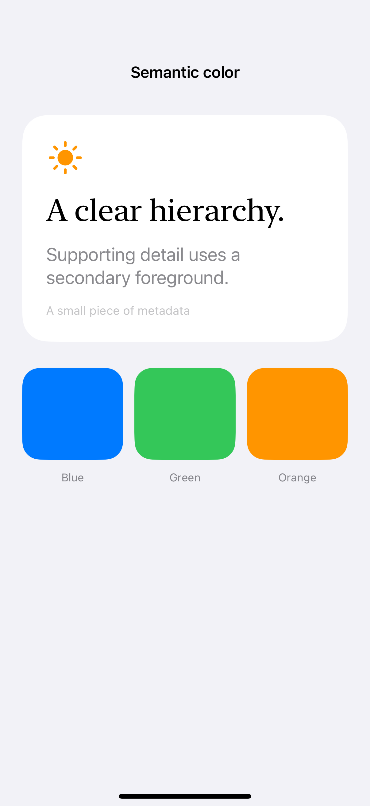
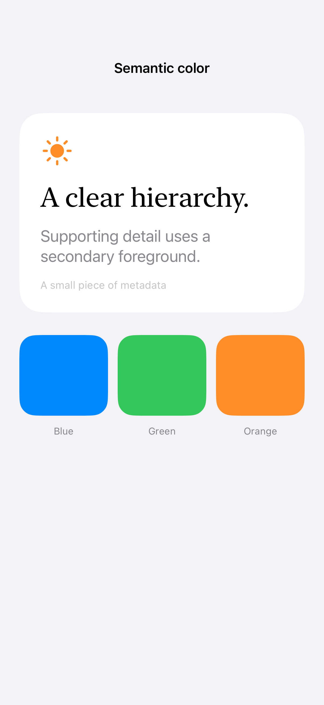

# Semantic colors and contrast

Semantic colors describe a role rather than a fixed appearance, allowing surfaces and foreground hierarchy to adapt to light, dark, and increased contrast.

## SwiftUI

```swift
import SwiftUI

struct SemanticCard: View {
    var body: some View {
        VStack(alignment: .leading, spacing: 12) {
            Text("A clear hierarchy").font(.title2).foregroundStyle(.primary)
            Text("Supporting detail").foregroundStyle(.secondary)
            Text("Metadata").font(.caption).foregroundStyle(.tertiary)
        }
        .padding(24)
        .background(Color(uiColor: .secondarySystemGroupedBackground),
                    in: RoundedRectangle(cornerRadius: 24))
    }
}
```

## Captures

<!-- captures:start -->
### iPhone 16 Pro · iOS 18.5

default. light appearance; Large text; en_US.



### iPhone 17 Pro · iOS 26.5

default. light appearance; Large text; en_US.


### iPhone 18 Pro · iOS 27.0

default. light appearance; Large text; en_US.


<!-- captures:end -->

## Full example

[Open the complete runnable example](SemanticColorsContrastDemo.swift).

## Reference

[Apple: foregroundStyle](https://developer.apple.com/documentation/swiftui/color).
