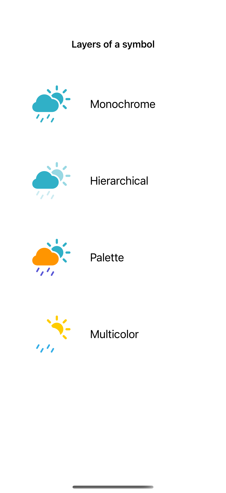
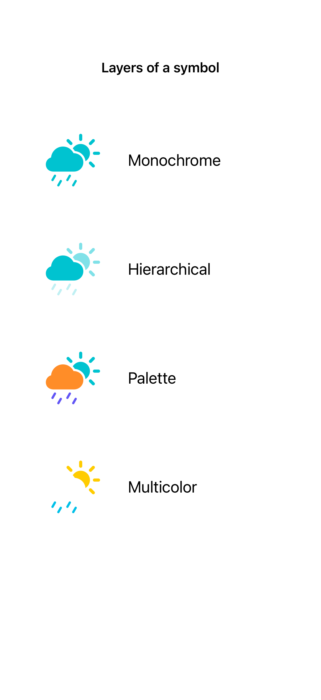

# SF Symbols rendering modes

Symbol rendering modes choose whether a symbol uses one color, layered emphasis, a custom palette, or its built-in colors.

## SwiftUI

```swift
import SwiftUI

struct PaletteSymbol: View {
    var body: some View {
        Image(systemName: "cloud.sun.rain.fill")
            .symbolRenderingMode(.palette)
            .foregroundStyle(.orange, .teal, .indigo)
            .font(.system(size: 80))
    }
}
```

## Captures

<!-- captures:start -->
### iPhone 16 Pro · iOS 18.5

default. light appearance; Large text; en_US.



### iPhone 17 Pro · iOS 26.5

default. light appearance; Large text; en_US.


### iPhone 18 Pro · iOS 27.0

default. light appearance; Large text; en_US.


<!-- captures:end -->

## Full example

[Open the complete runnable example](SymbolRenderingModesDemo.swift).

## Reference

[Apple: symbolRenderingMode](https://developer.apple.com/documentation/swiftui/view/symbolrenderingmode(_:)).
