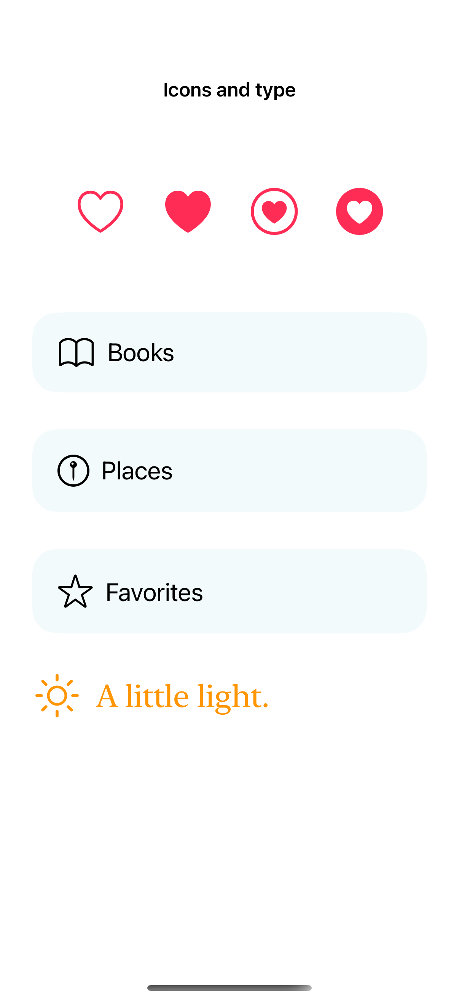
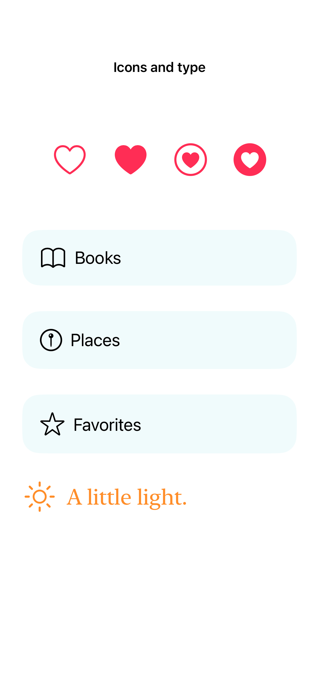

# Symbol variants and alignment

Symbol variants change a symbol’s shape, while font weight and image scale help it sit naturally alongside text.

## SwiftUI

```swift
import SwiftUI

struct FilledLabel: View {
    var body: some View {
        Label("Favorites", systemImage: "star")
            .symbolVariant(.fill)
            .font(.title2.weight(.medium))
            .imageScale(.large)
            .foregroundStyle(.orange)
    }
}
```

## Captures

<!-- captures:start -->
### iPhone 16 Pro · iOS 18.5

default. light appearance; Large text; en_US.



### iPhone 17 Pro · iOS 26.5

default. light appearance; Large text; en_US.


### iPhone 18 Pro · iOS 27.0

default. light appearance; Large text; en_US.


<!-- captures:end -->

## Full example

[Open the complete runnable example](SymbolVariantsAlignmentDemo.swift).

## Reference

[Apple: symbolVariant](https://developer.apple.com/documentation/swiftui/view/symbolvariant(_:)).
