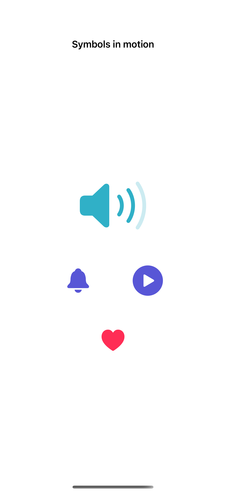
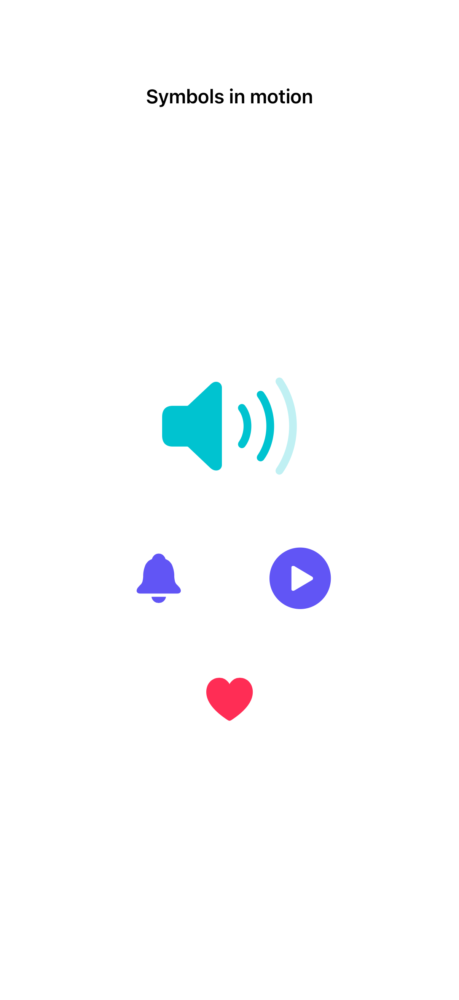

# Variable symbols and effects

Variable symbols can show changing values, and symbol effects add native motion when an action or state changes.

## SwiftUI

```swift
import SwiftUI

struct SymbolFeedback: View {
    @Environment(\.accessibilityReduceMotion) private var reduceMotion
    @State private var count = 0
    var body: some View {
        Button { count += 1 } label: {
            Image(systemName: "bell.fill")
                .font(.largeTitle).symbolEffect(.bounce, value: count)
        }
        .accessibilityLabel("Ring bell")
        .symbolEffectsRemoved(reduceMotion)
    }
}
```

## Captures

<!-- captures:start -->
### iPhone 16 Pro · iOS 18.5

default. light appearance; Large text; en_US.



### iPhone 17 Pro · iOS 26.5

default. light appearance; Large text; en_US.


<!-- captures:end -->

## Full example

[Open the complete runnable example](VariableSymbolsEffectsDemo.swift).

## Reference

[Apple: Image.init(systemName:variableValue:)](https://developer.apple.com/documentation/swiftui/view/symboleffect(_:options:value:)).
