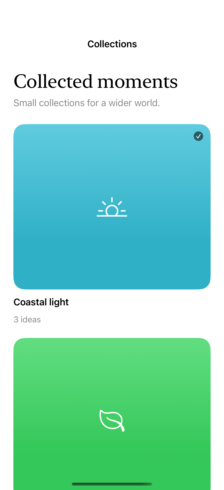
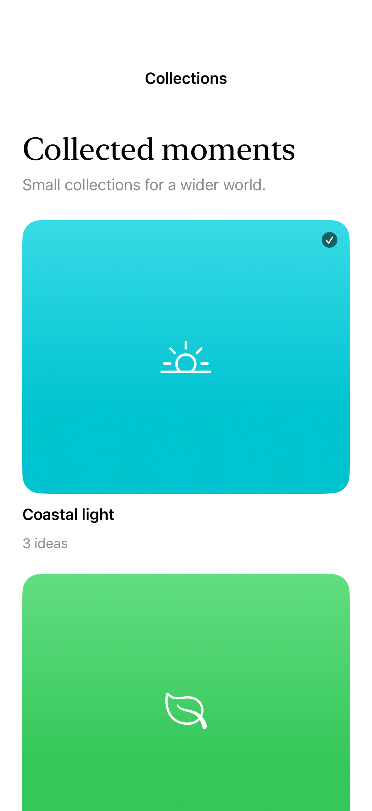

# A grid that uses the window

Adaptive grid columns respond to the available width, while a content-width limit keeps cards and reading surfaces from stretching across a large window.

## SwiftUI

```swift
import SwiftUI

struct FlexibleCardGrid: View {
    var body: some View {
        ScrollView {
            LazyVGrid(columns: [GridItem(.adaptive(minimum: 180), spacing: 16)]) {
                ForEach(1...12, id: \.self) { number in
                    Text("Collection \(number)")
                        .frame(maxWidth: .infinity, minHeight: 140)
                        .background(.teal.opacity(0.12), in: .rect(cornerRadius: 20))
                }
            }.padding().frame(maxWidth: 1100).frame(maxWidth: .infinity)
        }
    }
}
```

## Captures

<!-- captures:start -->
### iPhone 16 Pro · iOS 18.5

default. light appearance; Large text; en_US.



### iPhone 17 Pro · iOS 26.5

default. light appearance; Large text; en_US.


<!-- captures:end -->

## Full example

[Open the complete runnable example](AdaptiveContentDensityDemo.swift).

## Reference

[Apple: LazyVGrid](https://developer.apple.com/documentation/swiftui/lazyvgrid).
