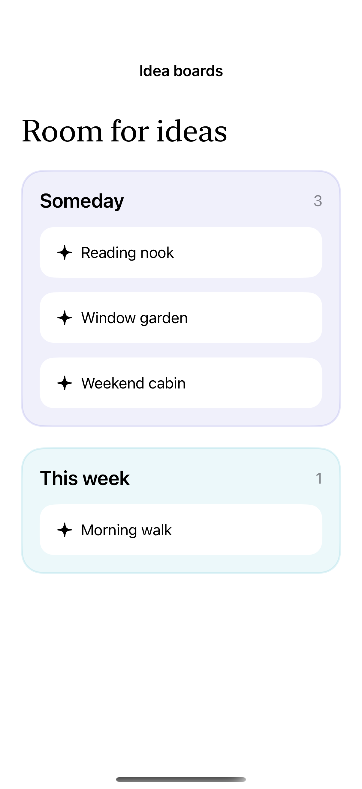
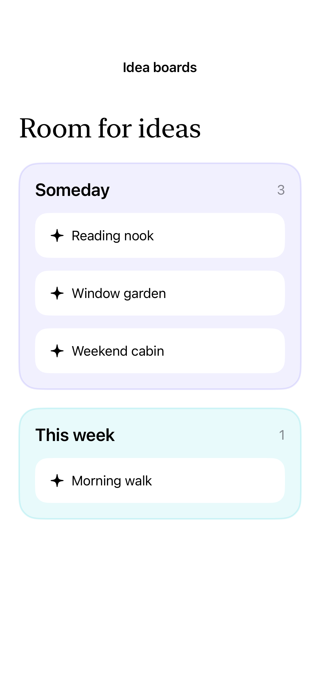

# Drag between collections

Draggable values and drop destinations move items between two collections; the same interaction works in stacked or side-by-side layouts.

## SwiftUI

```swift
import SwiftUI

struct MoveAnIdea: View {
    @State private var source = ["Reading nook", "Window garden"]
    @State private var destination: [String] = []
    var body: some View {
        HStack {
            VStack { ForEach(source, id: \.self) { Text($0).padding().draggable($0) } }
            VStack {
                Text("This week").font(.headline)
                ForEach(destination, id: \.self) { Text($0) }
            }
            .frame(minWidth: 120, minHeight: 160)
            .background(.teal.opacity(0.12))
            .dropDestination(for: String.self) { values, _ in
                let moved = values.filter { source.contains($0) }
                source.removeAll { moved.contains($0) }
                destination.append(contentsOf: moved)
                return !moved.isEmpty
            }
        }
    }
}
```

## Captures

<!-- captures:start -->
### iPhone 16 Pro · iOS 18.5

default. light appearance; Large text; en_US.



### iPhone 17 Pro · iOS 26.5

default. light appearance; Large text; en_US.



### iPhone 18 Pro · iOS 27.0

default. light appearance; Large text; en_US.


<!-- captures:end -->

## Full example

[Open the complete runnable example](DragBetweenCollectionsDemo.swift).

## Reference

[Apple: draggable](https://developer.apple.com/documentation/swiftui/view/dropdestination(for:action:istargeted:)).
