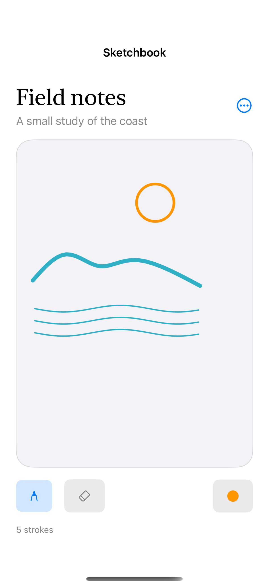
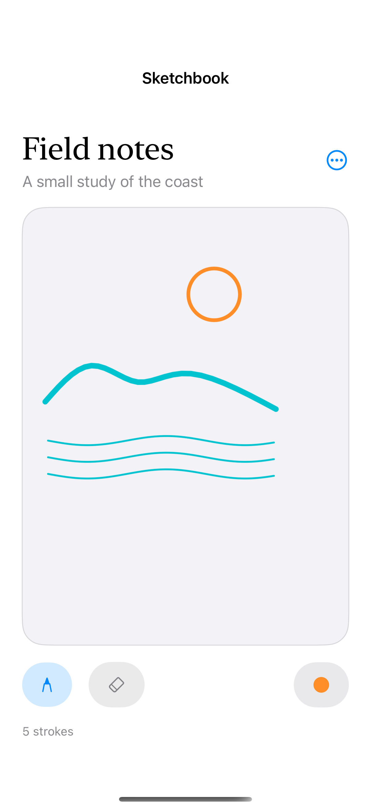
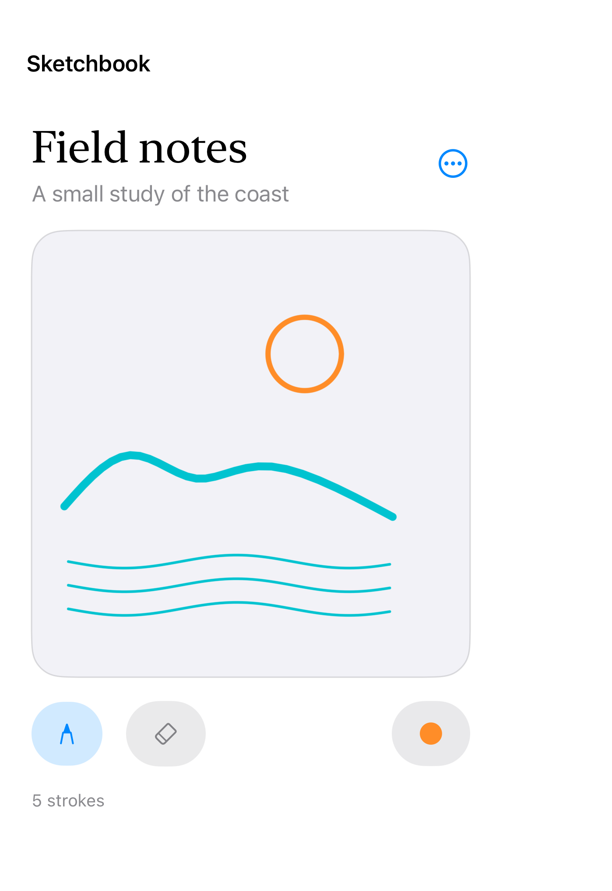

# A native drawing canvas

PencilKit provides editable native strokes; this canvas accepts finger input, while Apple Pencil behavior requires a compatible iPad and Pencil.

## SwiftUI

```swift
import SwiftUI
import PencilKit

struct DrawingCanvas: UIViewRepresentable {
    @Binding var drawing: PKDrawing
    func makeCoordinator() -> Coordinator { Coordinator(self) }
    func makeUIView(context: Context) -> PKCanvasView {
        let canvas = PKCanvasView()
        canvas.drawingPolicy = .anyInput
        canvas.tool = PKInkingTool(.pen, color: .systemTeal, width: 5)
        canvas.delegate = context.coordinator
        return canvas
    }
    func updateUIView(_ canvas: PKCanvasView, context: Context) {
        context.coordinator.parent = self
        if canvas.drawing != drawing { canvas.drawing = drawing }
    }
    final class Coordinator: NSObject, PKCanvasViewDelegate {
        var parent: DrawingCanvas
        init(_ parent: DrawingCanvas) { self.parent = parent }
        func canvasViewDrawingDidChange(_ canvas: PKCanvasView) { parent.drawing = canvas.drawing }
    }
}
```

## Captures

<!-- captures:start -->
### iPhone 16 Pro · iOS 18.5

default. light appearance; Large text; en_US.



### iPhone 17 Pro · iOS 26.5

default. light appearance; Large text; en_US.



### iPhone Duo · iOS 27.1

default. light appearance; Large text; en_US.


<!-- captures:end -->

## Full example

[Open the complete runnable example](PencilDrawingCanvasDemo.swift).

## Reference

[Apple: PKCanvasView](https://developer.apple.com/documentation/pencilkit/pkcanvasview).
