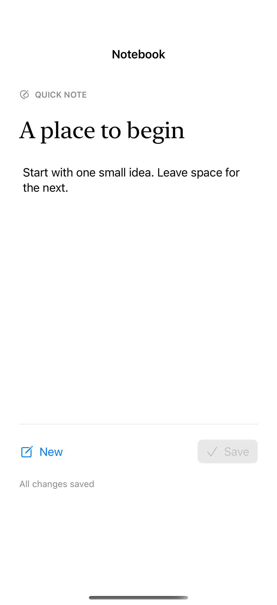
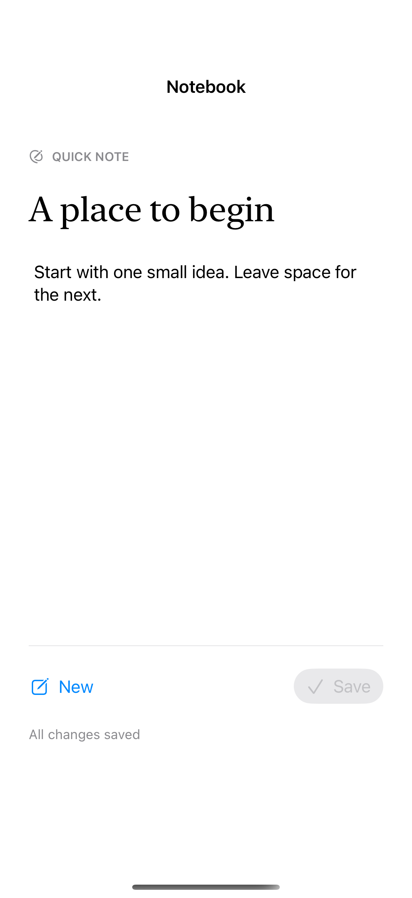
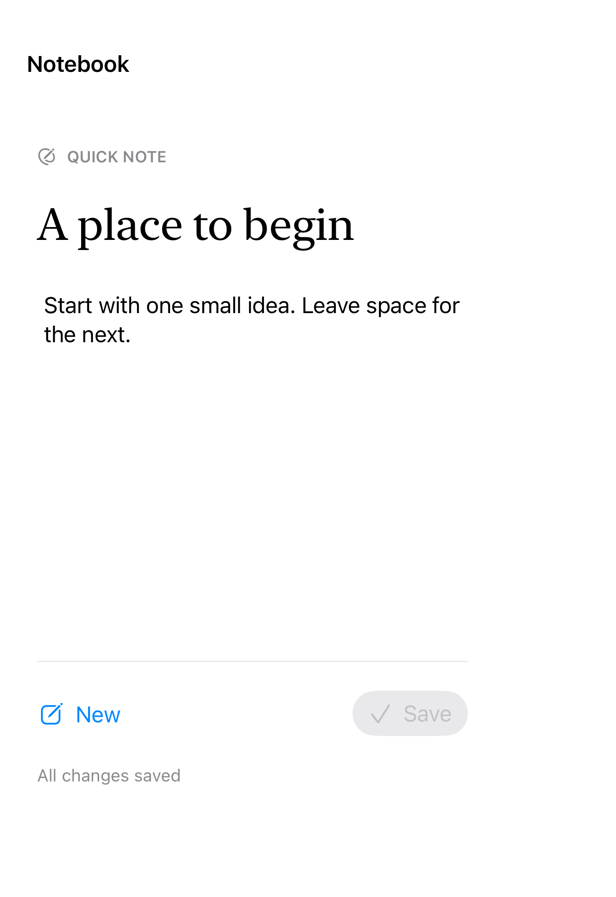

# Pointer and keyboard actions

Native buttons support touch and hardware-keyboard shortcuts; hover effects add pointer feedback on supported devices without replacing the action.

## SwiftUI

```swift
import SwiftUI

struct ShortcutButton: View {
    @State private var saved = false
    var body: some View {
        Button(saved ? "Saved" : "Save", systemImage: "checkmark") { saved = true }
            .keyboardShortcut("s", modifiers: .command)
            .buttonStyle(.borderedProminent)
            .hoverEffect(.lift)
    }
}
```

## Captures

<!-- captures:start -->
### iPhone 16 Pro · iOS 18.5

default. light appearance; Large text; en_US.



### iPhone 17 Pro · iOS 26.5

default. light appearance; Large text; en_US.



### iPhone Duo · iOS 27.1

default. light appearance; Large text; en_US.


<!-- captures:end -->

## Full example

[Open the complete runnable example](PointerKeyboardActionsDemo.swift).

## Reference

[Apple: keyboardShortcut](https://developer.apple.com/documentation/swiftui/view/keyboardshortcut(_:modifiers:)).
