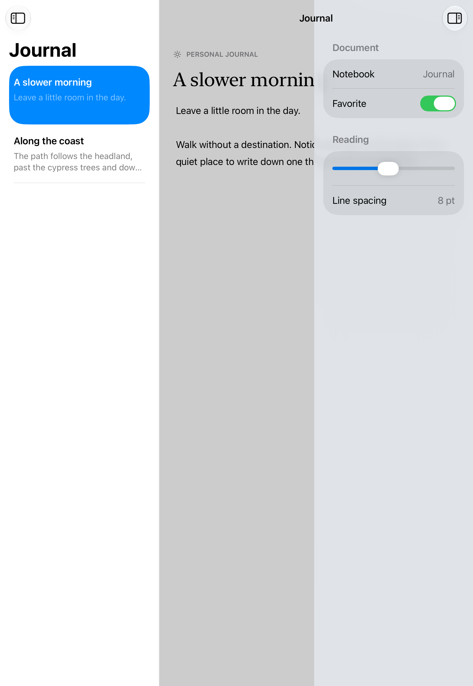

# A workspace with an inspector

A split view can show a sidebar, content column, detail, and inspector together; compact windows adapt those regions into navigation and a sheet.

## SwiftUI

```swift
import SwiftUI

struct DocumentWorkspace: View {
    @State private var inspector = false
    var body: some View {
        NavigationSplitView {
            List { NavigationLink("Journal") { Text("A slower morning") } }
                .navigationTitle("Notebooks")
        } detail: {
            Text("A slower morning")
                .toolbar {
                    Button("Inspector", systemImage: "sidebar.right") { inspector.toggle() }
                }
                .inspector(isPresented: $inspector) {
                    Form { LabeledContent("Notebook", value: "Journal") }
                        .inspectorColumnWidth(min: 240, ideal: 280, max: 340)
                }
        }
    }
}
```

## Captures

<!-- captures:start -->
### iPhone 16 Pro · iOS 18.5

default. light appearance; Large text; en_US.


### iPhone 17 Pro · iOS 26.5

default. light appearance; Large text; en_US.


### iPhone Duo · iOS 27.1

default. light appearance; Large text; en_US.


### iPad Pro 11-inch (M5) · iOS 27.0

Native inspector overlays and dims the detail in this portrait width; the document is obscured behind it. This is an adapted overlay state, not proof of four simultaneous columns or an unobscured editing workspace.. light appearance; Large text; en_US.



### iPhone 18 Pro · iOS 27.0

default. light appearance; Large text; en_US.


<!-- captures:end -->

## Full example

[Open the complete runnable example](WideInspectorWorkspaceDemo.swift).

## Reference

[Apple: NavigationSplitView](https://developer.apple.com/documentation/swiftui/navigationsplitview).
