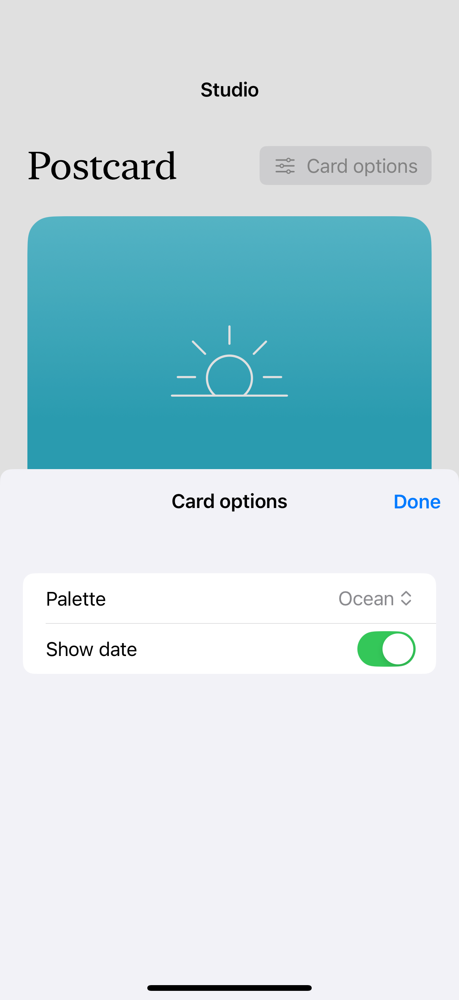
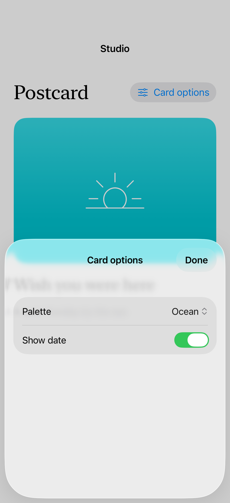
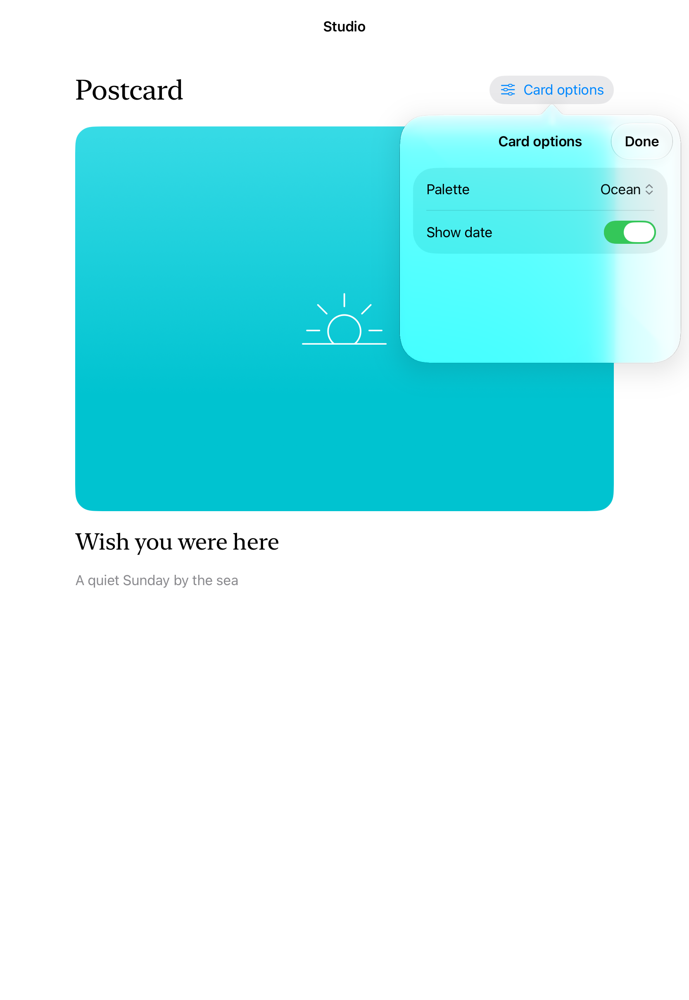
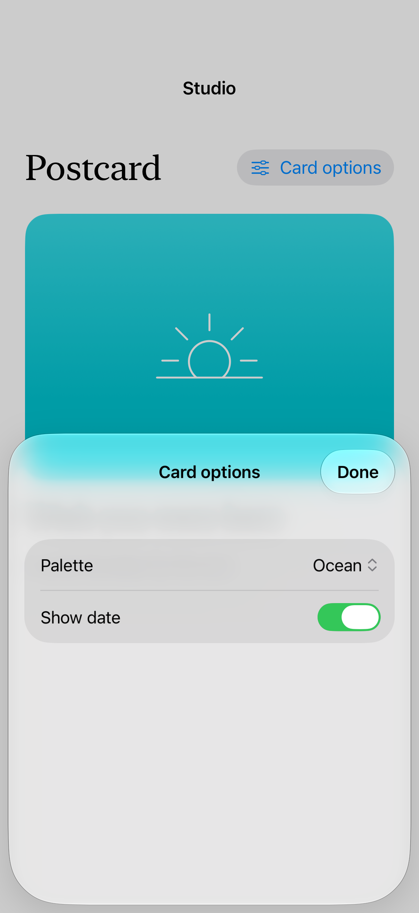

# An anchored popover

A popover remains anchored in a regular-width context and adapts to a sheet in compact contexts; changing its settings updates the underlying card.

## SwiftUI

```swift
import SwiftUI

struct AnchoredOptions: View {
    @State private var presented = false
    @State private var showDate = true
    var body: some View {
        Button("Options", systemImage: "slider.horizontal.3") { presented = true }
            .popover(isPresented: $presented, arrowEdge: .top) {
                Toggle("Show date", isOn: $showDate).padding(24)
                    .frame(idealWidth: 300, idealHeight: 140)
                    .presentationCompactAdaptation(.sheet)
            }
    }
}
```

## Captures

<!-- captures:start -->
### iPhone 16 Pro · iOS 18.5

default. light appearance; Large text; en_US.



### iPhone 17 Pro · iOS 26.5

default. light appearance; Large text; en_US.



### iPad Pro 11-inch (M5) · iOS 27.0

Popover content and source are visible over the postcard. No obvious clipping; native translucent surface is expected.. light appearance; Large text; en_US.



### iPhone 18 Pro · iOS 27.0

default. light appearance; Large text; en_US.


<!-- captures:end -->

## Full example

[Open the complete runnable example](WidePopoverAdaptationDemo.swift).

## Reference

[Apple: popover](https://developer.apple.com/documentation/swiftui/view/popover(ispresented:attachmentanchor:arrowedge:content:)).
